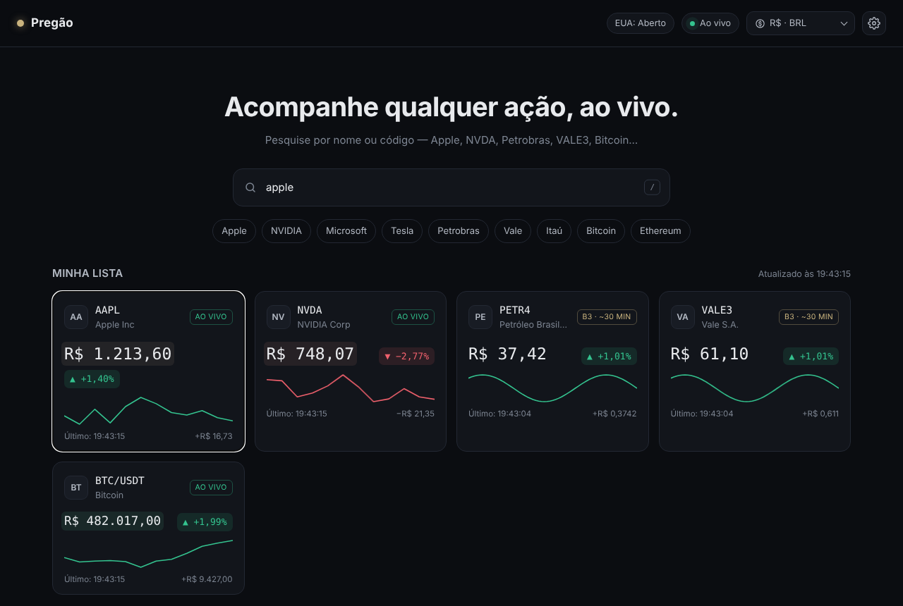

# Pregão — Bolsa em tempo real

Painel simples para acompanhar ações (EUA e B3) e criptomoedas com preço **ao vivo**.
É HTML + CSS + JavaScript puro: não precisa instalar nada.



## Como rodar

1. Crie uma chave **grátis** em <https://finnhub.io/register>.
2. Abra o `index.html` no navegador (dois cliques já funciona).
3. Cole a chave na janela de configurações (ícone ⚙) e clique em **Salvar e conectar**.
4. (Opcional) Para buscar qualquer ação da B3, crie um token grátis em <https://brapi.dev/dashboard> e cole no segundo campo.

> As chaves ficam salvas **só no seu navegador** (localStorage). Não coloque chaves no código antes de subir pro GitHub.

### Publicar no GitHub Pages
`Settings → Pages → Branch: main / (root) → Save`. Em ~1 minuto o site fica em
`https://SEU-USUARIO.github.io/NOME-DO-REPO/`.

## De onde vêm os dados (e o que é tempo real de verdade)

| Ativo | Fonte | Atualização |
|---|---|---|
| Ações dos EUA (AAPL, NVDA…) | Finnhub WebSocket | **Tempo real**: cada negócio fechado aparece na hora (no pregão americano: 11h30–18h em Brasília; 10h30–17h quando os EUA estão no horário de verão). |
| Cripto (BTC, ETH…) | Finnhub WebSocket (Binance) | **Tempo real, 24h por dia**. Bom para testar à noite e no fim de semana. |
| Ações da B3 (PETR4, VALE3…) | brapi | **Atraso de ~30 min** no plano grátis. Nenhuma API gratuita entrega a B3 em tempo real (a B3 cobra pela licença desses dados). |

Limites do plano grátis da Finnhub: 60 requisições/minuto e até 50 ativos ao vivo ao mesmo tempo.

## Funcionalidades

- Busca de empresas pelo nome ou código (EUA, B3 e criptos), com navegação por setas e `Enter`. Atalho: tecla `/`.
- Cards com preço piscando verde/vermelho a cada negócio, variação do dia e mini-gráfico.
- Painel de detalhes: gráfico com mira e tooltip, abertura, máxima, mínima, fechamento anterior, valor de mercado, setor e site.
- Selo de status em cada ativo: **AO VIVO**, **B3 · ~30 MIN**, **AGUARDANDO** ou **ERRO**.
- **Seletor de moeda** no topo: converte todos os preços (BRL, USD, EUR, GBP, JPY…) pelo câmbio de referência do dia (open.er-api / Frankfurter, sem chave). A variação em % não muda.
- Status do mercado americano (aberto, pré-mercado, after-market, fechado).
- Reconexão automática do WebSocket.
- A lista fica salva no navegador.

## Estrutura

```
index.html   → estrutura da página
style.css    → visual (tema escuro), dividido em blocos numerados
app.js       → lógica, dividida em 13 blocos comentados:
               1 config · 2 estado · 3 utilitários · 4 APIs · 5 WebSocket
               6 renderização · 7 painel de detalhes · 8 lista · 9 busca
               10 status do mercado · 11 timers · 12 configurações · 13 init
```

## Limitações conhecidas

- O gráfico das ações dos EUA começa vazio e vai se formando conforme os negócios chegam (o histórico intradiário da Finnhub é pago).
- Ações de outras bolsas (Europa, Ásia) aparecem na busca da Finnhub, mas a cotação delas é paga — o card mostra "Fora do plano grátis".

*Não é recomendação de investimento.*
