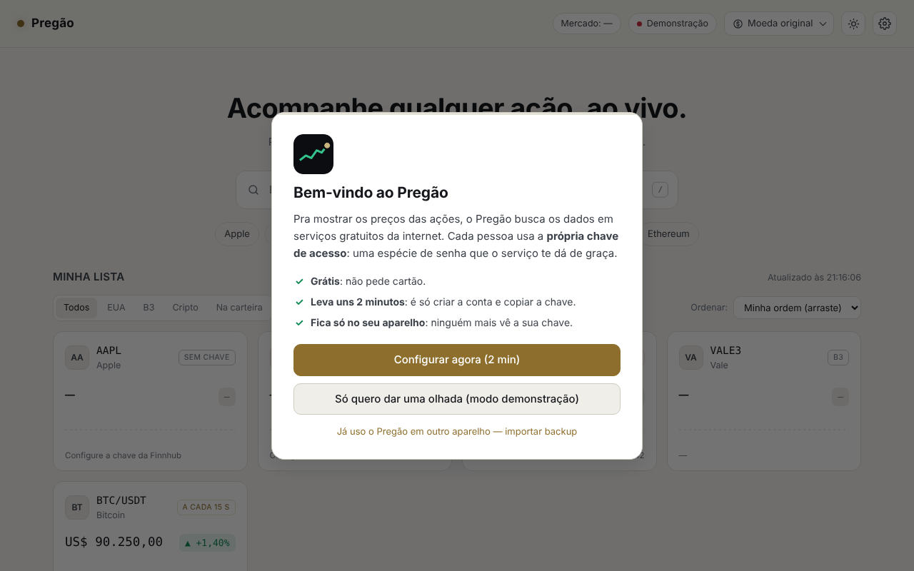

# Pregão — Bolsa em tempo real

Painel para acompanhar **ações dos EUA, da B3 e criptomoedas**, com preço ao vivo, carteira, alertas e gráficos.
Feito em HTML, CSS e JavaScript puro, sem nada pra instalar. Também pode ser **instalado como app** no celular ou no PC.

### ▶ Acesse: **<https://rafael26042007-max.github.io/pregao/>**

> O projeto se chamava `bolsa-tempo-real`. O endereço antigo (`…/bolsa-tempo-real/`) **não funciona mais**: quem instalou o app por ele precisa instalar de novo pelo link acima (e importar o backup).


---

## Sumário
- [Começar a usar](#começar-a-usar)
- [Funcionalidades](#funcionalidades)
- [De onde vêm os dados](#de-onde-vêm-os-dados)
- [Configurações](#configurações)
- [Rodar e publicar o código](#rodar-e-publicar-o-código)
- [Estrutura do código](#estrutura-do-código)
- [Limitações conhecidas](#limitações-conhecidas)
- [Histórico de versões](#histórico-de-versões)
- [Créditos](#créditos)

---

## Começar a usar

Abra o link acima. Na primeira vez aparece o **guia de primeiros passos**, com três caminhos:



| Opção | Pra quem é |
|---|---|
| **Configurar agora (2 min)** | Quem quer tudo funcionando. O guia explica o que é uma chave de API, mostra **onde clicar** em cada site e **testa a chave** antes de seguir. |
| **Só quero dar uma olhada** | Quem quer testar sem criar conta: é o **modo demonstração**, sem chave nenhuma. Funcionam cripto e as ações de teste da B3 (PETR4, VALE3, MGLU3, ITUB4). |
| **Já uso o Pregão em outro aparelho** | Quem já configurou em outro lugar: importa o **backup** e traz tudo. |

### As chaves de API (todas grátis, sem cartão)
| Serviço | Obrigatória? | Pra que serve | Criar conta | Já tem conta? A chave fica em… |
|---|---|---|---|---|
| **Finnhub** | Sim | Preço ao vivo de EUA e cripto, busca, notícias, indicadores | <https://finnhub.io/register> | <https://finnhub.io/dashboard> → **API Key** |
| **brapi** | Não | Todas as ações da B3 (sem ela, só as 4 de teste) | <https://brapi.dev/dashboard> | <https://brapi.dev/dashboard> → **Chaves de API** |
| **Twelve Data** | Não | Gráficos com o mercado fechado (último pregão, 1 e 3 meses) | <https://twelvedata.com/register> | <https://twelvedata.com/account/api-keys> → **Reveal** |

> As chaves ficam salvas **só no navegador de quem usa**, separadas por navegador e por endereço do site. Quem abre o seu link não vê as suas chaves. Pra usar em outro navegador ou no celular, use o **backup** (veja [Configurações](#configurações)).

### Baixar o app (celular e PC)
Clique em **⤓ Baixar app** no topo. No celular, é o ícone ⤓ ao lado do ☀.
- **Android (Chrome) e PC (Chrome/Edge):** instala com um clique.
- **iPhone, Samsung Internet, Firefox:** esses navegadores não instalam com um clique, então o botão mostra o **passo a passo do seu aparelho** (no iPhone: *Compartilhar → Adicionar à Tela de Início*).
- **No computador**, a janela também mostra um **QR code**: aponte a câmera do celular e o Pregão abre lá.

É grátis e não passa por loja (não precisa de Play Store).

O app instalado se atualiza sozinho: cada mudança publicada aparece na próxima vez que você abre o app. Às vezes precisa abrir duas vezes.

---

## Funcionalidades

### Acompanhar preços
- **Cards** com preço, variação do dia e mini-gráfico. O preço **pisca** verde ou vermelho a cada negócio.
- **Selo de status** em cada ativo:

  | Selo | Significado |
  |---|---|
  | **AO VIVO** | Preço do momento (EUA e cripto). |
  | **B3 · ~30 MIN** | Ação brasileira, com ~30 min de atraso (limite da fonte grátis). |
  | **FECHADO** | A bolsa americana não está funcionando agora. |
  | **A CADA 15 S** | Sem conexão ao vivo (ela caiu, ou é o modo demonstração): o app atualiza a cada 15 s. |
  | **AGUARDANDO** | Esperando liberar os dados. O motivo aparece embaixo. |
  | **SEM CHAVE** | Esse ativo precisa da chave da Finnhub (ações dos EUA no modo demonstração). |
  | **ERRO** | Não deu pra buscar (código inexistente, ação fora do plano grátis…). O motivo aparece embaixo. |

- **Status da bolsa americana** no topo: aberta, pré-mercado, after-market, fechada ou feriado.
- **Seletor de moeda**: converte todos os preços para R$, US$, €, £, ¥ e outras pelo câmbio do dia. No celular, ele fica em ⚙ → Aparência.

### Buscar e ver antes de adicionar
- A **busca** encontra empresas dos EUA, da B3 e criptos pelo nome ou código, e já mostra **preço e variação** de cada resultado.
- **Clicar no resultado** abre o painel em modo **prévia** pra você ver tudo antes de decidir. O **+ Adicionar** coloca na lista.

### Painel de detalhes


- **Gráfico 1D / 1M / 3M** com mira e tooltip. No 1D, a linha tracejada é o fechamento anterior.
- Abertura, máxima, mínima, fechamento anterior, valor de mercado e volume.
- **Minha posição**: quantidade e preço médio. Mostra valor atual, investido, resultado total e do dia.
- **Alertas de preço** (veja abaixo).
- **Indicadores**: faixa de 52 semanas, P/L, lucro por ação, dividend yield e beta.
- **Notícias** dos últimos 7 dias (EUA e cripto), cada uma com o link *em português* pelo Google Tradutor.
- Dados da empresa: setor, bolsa, país, IPO e site.

### Minha carteira
- Registre quantas ações você tem e o preço médio no painel de cada ativo.
- O **resumo no topo da lista** soma tudo (EUA + B3 + cripto) na mesma moeda: **valor atual, resultado de hoje e resultado total**.
- Cada card mostra a sua quantidade e o lucro ou prejuízo.

### Alertas de preço
- 4 tipos: **preço acima de**, **preço abaixo de**, **alta do dia ≥ X%** e **queda do dia ≥ X%**.
- Quando dispara: aviso na tela, **notificação do sistema** (se você permitir), **som** e o título da aba pisca.
- Cada alerta dispara uma vez. Depois dá pra **reativar**. O sino 🔔 no card mostra os alertas ativos.

### Organizar a lista
- **Filtro**: Todos, EUA, B3, Cripto ou Na carteira.
- **Ordem**: a sua (**arrastando os cards**), maior alta, maior queda, nome ou maior posição.

### Outros
- **Tema claro, escuro ou do sistema** (botão ☀/☾ no topo ou em Configurações).
- **App instalável (PWA)**: botão **Baixar app**, ícone na tela inicial, abre sem a barra do navegador e até abre sem internet (os preços voltam quando a conexão volta).
- **Modo aplicativo**: no app instalado, bloqueia F12, Ctrl+Shift+I, Ctrl+U e o botão direito. Desligue em ⚙ → Aparência quando for programar. Não é segurança: o DevTools ainda abre pelo menu ⋮ do navegador.
- **Várias abas** abertas não brigam pela conexão: só uma conecta e repassa os preços para as outras.
- Lista, carteira, alertas e preferências ficam **salvos no navegador**.

---

## De onde vêm os dados

| Fonte | Usada para | Atualização | Limite grátis |
|---|---|---|---|
| **Finnhub** | Preço de EUA e cripto, busca, notícias, indicadores | **Tempo real** (WebSocket) | 60 pedidos/min · 1 conexão ao vivo por chave · 50 ativos ao vivo |
| **brapi** | Ações da B3 (cotação, gráfico, indicadores) | ~30 min de atraso | Cota mensal + limite de chamadas simultâneas |
| **Twelve Data** | Gráficos históricos de EUA e cripto | Ao abrir o gráfico | 8 pedidos/min · 800/dia |
| **open.er-api / Frankfurter** | Câmbio | 1x por dia | Sem chave |
| **Binance** | Variação de 24h das criptos e preço no modo demonstração | A cada 1 min (15 s na demonstração) | Sem chave |

**Por que a B3 não é em tempo real?** A B3 cobra pela licença dos dados ao vivo. Nenhuma fonte gratuita entrega isso, e o app mostra o selo de atraso em vez de fingir que é ao vivo.

**Como o app economiza as APIs:** a brapi tem uma **fila única** (1 pedido por vez, pausa automática ao receber 429), a Twelve Data tem uma fila de 8 pedidos/min, e os gráficos e as últimas cotações ficam **salvos no navegador**, então recarregar a página não gasta nada.

---

## Configurações


| Aba | O que tem |
|---|---|
| **Chaves de API** | Mostrar/ocultar e **testar** cada chave · links **criar conta** e **ver minha chave** · atalho **Importar backup** (enquanto não há chave) · **Abrir o guia passo a passo**. |
| **Aparência** | Tema, moeda, layout compacto, mini-gráficos, piscar preço, atalhos da busca e modo aplicativo. |
| **Atualização** | Status da conexão ao vivo, reconectar, intervalo da B3 (1 a 10 min) e uso das APIs. |
| **Alertas** | Som (com teste), notificações do sistema (permitir e testar) e lista de todos os alertas. |
| **Dados e backup** | **Exportar backup** (com ou sem as chaves) · **Importar backup** (substitui os dados atuais) · limpar cache · apagar tudo. |
| **Sobre** | Versão, fontes de dados e atalhos de teclado. |
| **Créditos** | Quem fez, fontes de dados, fontes tipográficas e hospedagem (também abre pelo link **Créditos** no rodapé). |

**Atalhos:** `/` vai pra busca · `↑ ↓ Enter` navegam nos resultados · `Esc` fecha painel e janelas.

> O arquivo de backup **com as chaves** dá acesso às suas contas nos serviços. Guarde com cuidado e **não suba pro GitHub**.

---

## Rodar e publicar o código

### No PC
Baixe o código:
```bash
git clone https://github.com/rafael26042007-max/pregao.git
```
Se você já tinha a pasta antiga (`bolsa-tempo-real`), ela continua funcionando: o GitHub redireciona o `git pull`/`git push`. Para deixar o endereço certinho, rode dentro dela:
```bash
git remote set-url origin https://github.com/rafael26042007-max/pregao.git
```

- **Mais simples:** abra o `index.html` com dois cliques. Tudo funciona, menos instalar como app (precisa de `http(s)`).
- **Pelo IntelliJ / WebStorm** (`localhost:63342`): funciona. Se aparecer **404** no `manifest.json` ou no service worker, vá em *Settings → Build, Execution, Deployment → Debugger* e marque **Allow unsigned requests**. O servidor embutido recusa pedidos "não assinados" pelo token `_ijt` da URL.
- Os dados ficam separados por endereço: o Pregão do `localhost` e o do `github.io` têm chaves e listas diferentes. Use o backup pra levar de um pro outro.

### Publicar no GitHub Pages
1. No repositório: **Settings → Pages**. Se o GitHub estiver traduzido: **Configurações → Páginas**.
2. **Source:** *Deploy from a branch* ("Implantar a partir de uma ramificação").
3. **Branch** ("Filial"): troque **None** ("Nenhum") por **main**, pasta **/ (root)** ("/ (raiz)"), e clique em **Save** ("Salvar").
4. Em 1 a 3 minutos aparece *"Your site is live at…"* ("Seu site está online em…"). A aba **Actions** mostra o andamento ("pages build and deployment").

**Não preencha** o campo *Custom domain* ("Domínio personalizado"): ele é só pra quem comprou um domínio próprio, e colar o link do github.io ali gera um aviso de erro.

Depois disso, **cada `git push` na `main` republica o site sozinho**.

**Renomear o repositório** muda o endereço do site (`…github.io/NOME-NOVO/`) e o antigo para de funcionar. Os dados salvos ficam no endereço antigo, então use o backup.

---

## Estrutura do código

```
index.html            → estrutura da página
style.css             → visual (temas escuro e claro), em blocos numerados
app.js                → núcleo do app, em blocos comentados:
                        1 config · 2 estado · 2.1 ganchos · 3 utilitários
                        4 APIs (4.1 EUA · 4.2 B3 · 4.3 cripto · 4.4 histórico)
                        5 tempo real (WebSocket) · 6 renderização · 7 painel
                        8 lista · 9 busca · 10 mercado e câmbio · 11 timers
                        12 configurações · 13 inicialização
js/alertas.js         → alertas de preço
js/carteira.js        → minha carteira e resumo
js/lista.js           → filtrar, ordenar e arrastar
js/noticias.js        → indicadores e notícias do painel
js/tema-pwa.js        → tema claro/escuro, baixar/instalar o app e modo aplicativo
js/vendor/qrcode.js   → biblioteca de QR code (qrcode-generator, MIT)
js/configuracoes.js   → janela de configurações com abas
js/boas-vindas.js     → guia de primeiros passos e modo demonstração
sw.js                 → service worker (app instalável / abre sem internet)
sitemap.xml           → mapa do site para o Google
manifest.json         → nome, cores e ícones do app
icons/                → ícones do app e og-image.png (prévia do link nas redes sociais)
docs/                 → imagens deste README
```

### Como os recursos se ligam ao núcleo (ganchos)
Os arquivos da pasta `js/` não mexem no `app.js`. Eles se **inscrevem em eventos** com `on(nome, função)`, e o `app.js` avisa com `emit(nome, ...)`:

| Gancho | Quando acontece |
|---|---|
| `init` | O app terminou de iniciar |
| `price(símbolo)` | O preço de um ativo mudou |
| `cardCreated(símbolo, elemento)` / `card(símbolo, refs, dados)` | Card criado / atualizado |
| `detailOpen(símbolo)` / `detail(símbolo, dados)` / `detailClose(símbolo)` | Painel de detalhes |
| `listChanged` | Ativo adicionado ou removido |
| `needKey` | O app abriu sem a chave da Finnhub (o guia usa isso) |
| `keysChanged` | As chaves foram salvas |

Pra criar um recurso novo, basta um arquivo em `js/` que use esses ganchos, mais um `<script>` no `index.html` e o nome do arquivo na lista do `sw.js` (aumentando o número do `CACHE`).

### Dados salvos no navegador (localStorage)
| Chave | O que guarda |
|---|---|
| `pregao.config` | Chaves de API |
| `pregao.watchlist` | Lista de ativos (e a ordem) |
| `pregao.portfolio` | Carteira |
| `pregao.alerts` | Alertas |
| `pregao.prefs` | Preferências das Configurações |
| `pregao.listview` | Filtro e ordenação da lista |
| `pregao.theme` / `pregao.currency` | Tema e moeda |
| `pregao.demo` | Escolheu o modo demonstração |
| `pregao.hist` / `pregao.b3cache` | Cache de gráficos e últimas cotações da B3 |

---

## Limitações conhecidas

- **B3 com atraso de ~30 min** no plano grátis da brapi. O gráfico do dia (1D) da B3 só funciona nas ações de teste (PETR4, VALE3, MGLU3, ITUB4). As outras mostram 1M/3M.
- Sem a chave da Twelve Data, o gráfico 1D das ações dos EUA se forma só com os negócios ao vivo. Com o mercado fechado, ele fica vazio.
- **1 conexão ao vivo por chave da Finnhub:** com o Pregão aberto no PC e no celular com a mesma chave, um deles fica em "A CADA 15 S". Várias abas no mesmo navegador funcionam normalmente.
- Ações de outras bolsas (Europa, Ásia) aparecem na busca, mas a cotação delas é paga na Finnhub.
- As notícias vêm em inglês (há o link de tradução). Não há notícias da B3 na fonte gratuita.
- Arrastar os cards funciona com o mouse. No celular, use a ordenação pelo menu.
- Os dados **não sincronizam** sozinhos entre aparelhos: use o backup.
- O botão **Instalar app** e as notificações no celular precisam do site em https (GitHub Pages).

---

## Histórico de versões

| Versão | O que entrou |
|---|---|
| **2.1** | Projeto renomeado para **pregao** (novo endereço), botão Baixar app (passo a passo por aparelho e QR code), aba de créditos, guia de primeiros passos, modo demonstração, links "ver minha chave", atalho de importar backup, modo aplicativo, topo ajustado no celular, correções do manifest e do backup |
| **2.0** | Alertas, carteira, filtro/ordem/arrastar, indicadores e notícias, tema claro, app instalável, Configurações com abas |
| **1.x** | Preços ao vivo, busca com prévia, seletor de moeda, gráficos 1D/1M/3M, fila da brapi, conexão compartilhada entre abas |

---

## Créditos

| Quem | Papel |
|---|---|
| **Rafael** ("Dev") · [github.com/rafael26042007-max](https://github.com/rafael26042007-max) | Criador do projeto: ideia, direção do produto, escolha dos recursos, testes no computador e no celular, caça aos bugs e publicação. |
| **Claude** (Anthropic) · assistente de IA | Programação, testes automatizados e documentação, em conversa com o Rafael, que pediu, revisou e testou cada mudança. |

**Dados:** [Finnhub](https://finnhub.io) · [brapi](https://brapi.dev) · [Twelve Data](https://twelvedata.com) · [ExchangeRate-API](https://www.exchangerate-api.com) e [Frankfurter](https://frankfurter.dev) · [Binance](https://www.binance.com)
**Fontes:** [Inter](https://rsms.me/inter/) (Rasmus Andersson) e [JetBrains Mono](https://www.jetbrains.com/lp/mono/), licença SIL Open Font, via Google Fonts
**Hospedagem:** [GitHub Pages](https://pages.github.com)
**QR code:** [qrcode-generator](https://github.com/kazuhikoarase/qrcode-generator) (Kazuhiko Arase, licença MIT)

Marcas e logos das empresas pertencem aos seus donos. © 2026 Rafael.

*Não é recomendação de investimento.*
