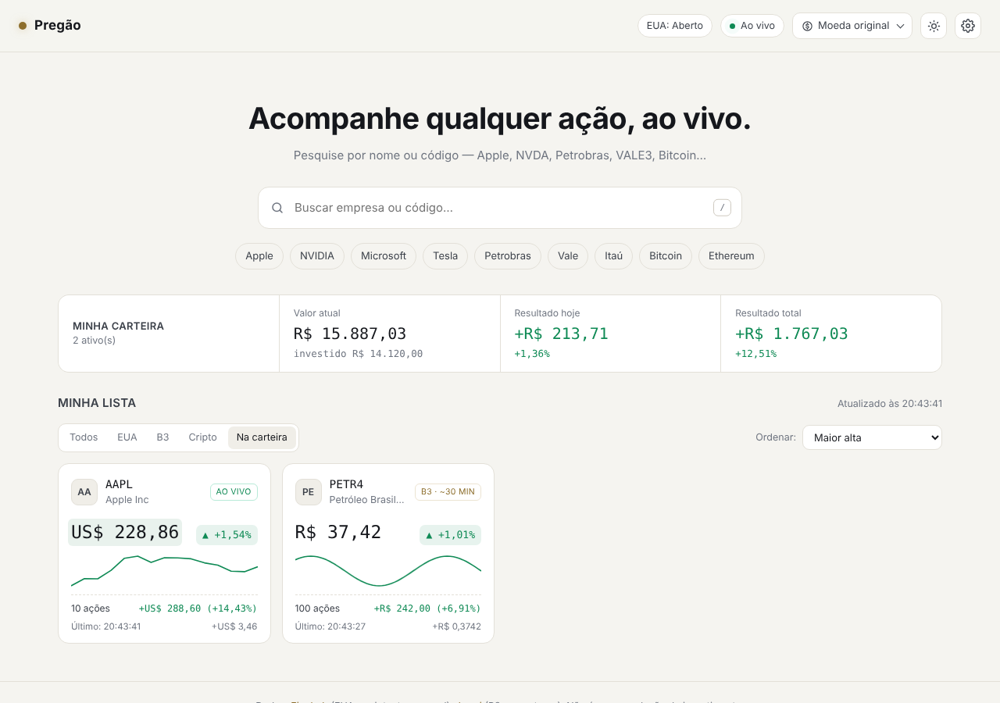
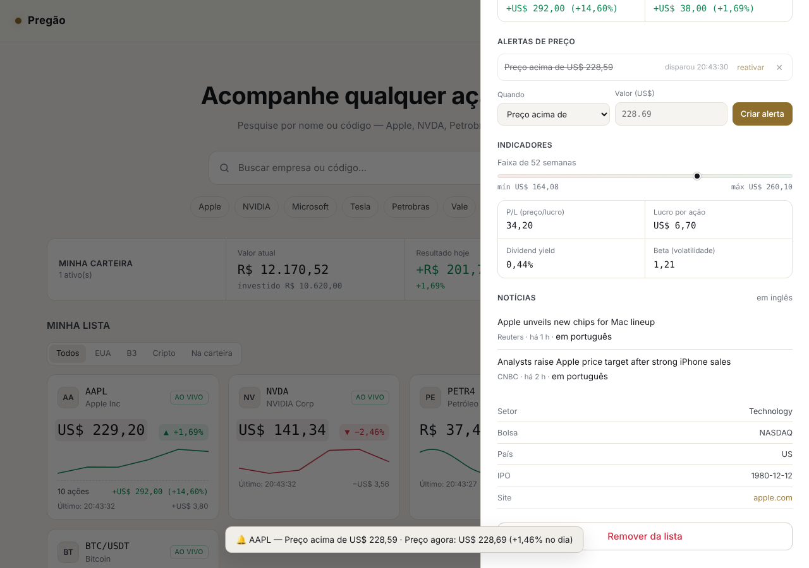
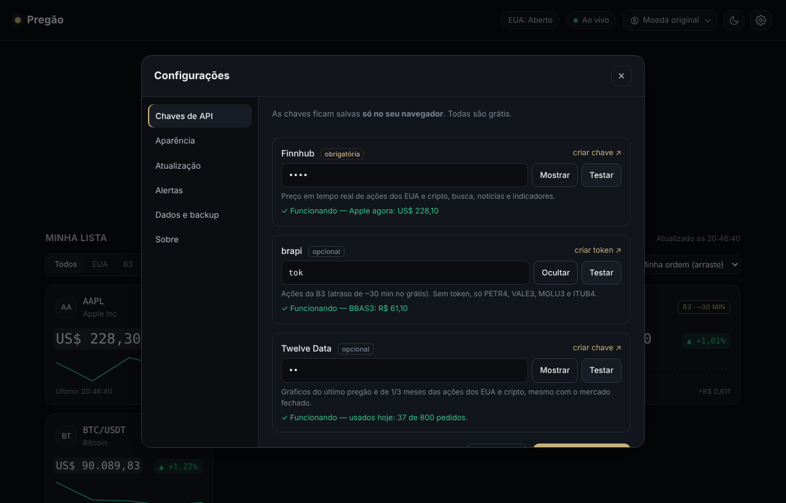

# Pregão — Bolsa em tempo real

Painel para acompanhar **ações dos EUA, da B3 e criptomoedas**, com preço ao vivo, carteira, alertas e gráficos.
Feito em HTML, CSS e JavaScript puro: não precisa instalar nada, e também pode ser **instalado como app** no celular ou no PC.



---

## Sumário
- [Como rodar](#como-rodar)
- [Funcionalidades](#funcionalidades)
- [De onde vêm os dados](#de-onde-vêm-os-dados)
- [Configurações](#configurações)
- [Estrutura do código](#estrutura-do-código)
- [Limitações conhecidas](#limitações-conhecidas)

---

## Como rodar

1. Crie uma chave **grátis** da Finnhub em <https://finnhub.io/register> (obrigatória).
2. Abra o `index.html` no navegador (dois cliques já funciona) **ou** acesse pelo GitHub Pages (veja abaixo).
3. Na janela de **Configurações → Chaves de API**, cole a chave, clique em **Testar** e depois em **Salvar e conectar**.
4. Opcionais, também grátis:
   - **brapi** (<https://brapi.dev/dashboard>): para buscar qualquer ação da B3. Sem ela, só PETR4, VALE3, MGLU3 e ITUB4 funcionam.
   - **Twelve Data** (<https://twelvedata.com/register>): gráficos do último pregão e de 1/3 meses das ações dos EUA e cripto, mesmo com o mercado fechado.

> As chaves ficam salvas **só no seu navegador** (localStorage). Nunca coloque chaves no código antes de subir pro GitHub.

### Publicar no GitHub Pages
`Settings → Pages → Branch: main / (root) → Save`. Em ~1 minuto o site fica em
`https://SEU-USUARIO.github.io/NOME-DO-REPO/`. Pelo GitHub Pages (https), o botão **Instalar app** aparece no topo.

---

## Funcionalidades

### Acompanhar preços
- **Cards** com preço, variação do dia e mini-gráfico. O preço **pisca** verde ou vermelho a cada negócio.
- **Selo de status** em cada ativo:

  | Selo | Significado |
  |---|---|
  | **AO VIVO** | Preço do momento (EUA e cripto). |
  | **B3 · ~30 MIN** | Ação brasileira, com ~30 min de atraso (limite da fonte grátis). |
  | **FECHADO** | A bolsa americana não está funcionando agora. |
  | **A CADA 15 S** | O ao vivo caiu e o app atualiza a cada 15 s até voltar. |
  | **AGUARDANDO** | Esperando liberar os dados. O motivo aparece embaixo. |

- **Status da bolsa americana** no topo: aberta, pré-mercado, after-market, fechada ou feriado.
- **Seletor de moeda**: converte todos os preços para R$, US$, €, £, ¥ e outras pelo câmbio do dia.

### Buscar e ver antes de adicionar
- A **busca** encontra empresas dos EUA, da B3 e criptos pelo nome ou código, e já mostra **preço e variação** de cada resultado.
- **Clicar no resultado** abre o painel em modo **prévia** pra você ver tudo antes de decidir. O **+ Adicionar** coloca na lista.

### Painel de detalhes


- **Gráfico 1D / 1M / 3M** com mira e tooltip. No 1D, a linha tracejada é o fechamento anterior.
- Abertura, máxima, mínima, fechamento anterior, valor de mercado e volume.
- **Minha posição**: quantidade e preço médio. Mostra valor atual, investido, resultado total e do dia.
- **Alertas de preço** (veja abaixo).
- **Indicadores**: faixa de 52 semanas, P/L, lucro por ação, dividend yield e beta.
- **Notícias** dos últimos 7 dias (EUA e cripto), cada uma com o link *em português* pelo Google Tradutor.
- Dados da empresa: setor, bolsa, país, IPO e site.

### Minha carteira
- Registre quantas ações você tem e o preço médio no painel de cada ativo.
- O **resumo no topo da lista** soma tudo (EUA + B3 + cripto) na mesma moeda: **valor atual, resultado de hoje e resultado total**.
- Cada card mostra a sua quantidade e o lucro ou prejuízo.

### Alertas de preço
- 4 tipos: **preço acima de**, **preço abaixo de**, **alta do dia ≥ X%** e **queda do dia ≥ X%**.
- Quando dispara: aviso na tela, **notificação do sistema** (se você permitir), **som** e o título da aba pisca.
- Cada alerta dispara uma vez. Depois dá pra **reativar**. O sino 🔔 no card mostra os alertas ativos.

### Organizar a lista
- **Filtro**: Todos, EUA, B3, Cripto ou Na carteira.
- **Ordem**: a sua (**arrastando os cards**), maior alta, maior queda, nome ou maior posição.

### Outros
- **Tema claro, escuro ou do sistema** (botão ☀/☾ no topo ou em Configurações).
- **App instalável (PWA)**: ícone na tela inicial e abre sem a barra do navegador.
- **Várias abas** abertas não brigam pela conexão: só uma conecta e repassa os preços para as outras.
- Lista, carteira, alertas e preferências ficam **salvos no navegador**.

---

## De onde vêm os dados

| Fonte | Usada para | Atualização | Limite grátis |
|---|---|---|---|
| **Finnhub** | Preço de EUA e cripto, busca, notícias, indicadores | **Tempo real** (WebSocket) | 60 pedidos/min · 1 conexão ao vivo por chave · 50 ativos ao vivo |
| **brapi** | Ações da B3 (cotação, gráfico 1M/3M, indicadores) | ~30 min de atraso | Cota mensal + limite de chamadas simultâneas |
| **Twelve Data** | Gráficos históricos de EUA e cripto | Ao abrir o gráfico | 8 pedidos/min · 800/dia |
| **open.er-api / Frankfurter** | Câmbio | 1x por dia | Sem chave |
| **Binance** | Variação de 24h das criptos | A cada 1 min | Sem chave |

**Por que a B3 não é em tempo real?** A B3 cobra pela licença dos dados ao vivo. Nenhuma fonte gratuita entrega isso, e o app mostra o selo de atraso em vez de fingir que é ao vivo.

**Como o app economiza as APIs:** a brapi tem uma **fila única** (1 pedido por vez, pausa automática ao receber 429), a Twelve Data tem uma fila de 8 pedidos/min, e os gráficos e as últimas cotações ficam **salvos no navegador**, então recarregar a página não gasta nada.

---

## Configurações



| Aba | O que tem |
|---|---|
| **Chaves de API** | Mostrar/ocultar e **testar** cada chave (mostra se funciona e o uso do dia). |
| **Aparência** | Tema, moeda, layout compacto, mini-gráficos, piscar preço e atalhos da busca. |
| **Atualização** | Status da conexão ao vivo, reconectar, intervalo da B3 (1 a 10 min) e uso das APIs. |
| **Alertas** | Som (com teste), notificações do sistema (permitir e testar) e lista de todos os alertas. |
| **Dados e backup** | **Exportar/importar backup** (.json), limpar cache e apagar tudo. |
| **Sobre** | Versão, fontes de dados e atalhos de teclado. |

**Atalhos:** `/` vai pra busca · `↑ ↓ Enter` navegam nos resultados · `Esc` fecha painel e janelas.

---

## Estrutura do código

```
index.html            → estrutura da página
style.css             → visual (temas escuro e claro), em blocos numerados
app.js                → núcleo do app, em blocos comentados:
                        1 config · 2 estado · 2.1 ganchos · 3 utilitários
                        4 APIs (4.1 EUA · 4.2 B3 · 4.3 cripto · 4.4 histórico)
                        5 tempo real (WebSocket) · 6 renderização · 7 painel
                        8 lista · 9 busca · 10 mercado e câmbio · 11 timers
                        12 configurações · 13 inicialização
js/alertas.js         → alertas de preço
js/carteira.js        → minha carteira e resumo
js/lista.js           → filtrar, ordenar e arrastar
js/noticias.js        → indicadores e notícias do painel
js/tema-pwa.js        → tema claro/escuro e instalação como app
js/configuracoes.js   → janela de configurações com abas
sw.js                 → service worker (app instalável / funciona offline)
manifest.json         → nome, cores e ícones do app
icons/                → ícones do app
```

### Como os recursos se ligam ao núcleo (ganchos)
Os arquivos da pasta `js/` não mexem no `app.js`. Eles se **inscrevem em eventos** com `on(nome, função)`, e o `app.js` avisa com `emit(nome, ...)`:

| Gancho | Quando acontece |
|---|---|
| `init` | O app terminou de iniciar |
| `price(símbolo)` | O preço de um ativo mudou |
| `cardCreated(símbolo, elemento)` / `card(símbolo, refs, dados)` | Card criado / atualizado |
| `detailOpen(símbolo)` / `detail(símbolo, dados)` / `detailClose(símbolo)` | Painel de detalhes |
| `listChanged` | Ativo adicionado ou removido |

Pra criar um recurso novo, basta um arquivo em `js/` que use esses ganchos, mais um `<script>` no `index.html`.

### Dados salvos no navegador (localStorage)
`pregao.config` (chaves) · `pregao.watchlist` (lista) · `pregao.portfolio` (carteira) · `pregao.alerts` (alertas) · `pregao.prefs` (preferências) · `pregao.listview` (filtro/ordem) · `pregao.theme` · `pregao.currency` · `pregao.hist` e `pregao.b3cache` (cache).

---

## Limitações conhecidas

- **B3 com atraso de ~30 min** no plano grátis da brapi. O gráfico do dia (1D) da B3 só funciona nas ações de teste (PETR4, VALE3, MGLU3, ITUB4). As outras mostram 1M/3M.
- Sem a chave da Twelve Data, o gráfico 1D das ações dos EUA se forma só com os negócios ao vivo. Com o mercado fechado, ele fica vazio.
- Ações de outras bolsas (Europa, Ásia) aparecem na busca, mas a cotação delas é paga na Finnhub.
- As notícias vêm em inglês (há o link de tradução). Não há notícias da B3 na fonte gratuita.
- Arrastar os cards funciona com o mouse. No celular, use a ordenação pelo menu.
- O botão **Instalar app** e as notificações no celular precisam do site em https (GitHub Pages).

*Não é recomendação de investimento.*
